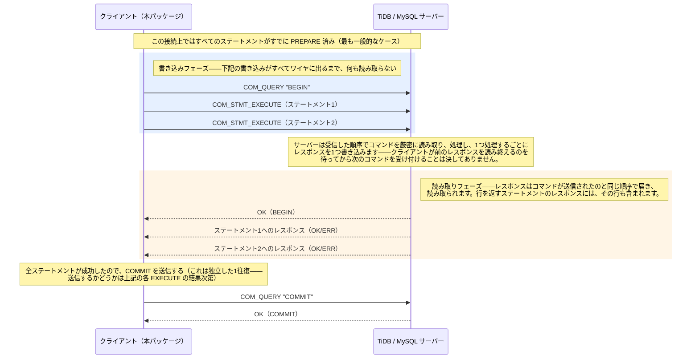

# tidb-binary-multistmt

[English](README.md) | [简体中文](README.zh-CN.md) | 日本語

1つのバッチ内の全ステートメントを、MySQL の**バイナリプロトコル**（`COM_STMT_PREPARE`/`COM_STMT_EXECUTE`）で**1回**の通信往復にまとめて送信します。ステートメントごとに1往復ではありません。

## 概要

- **何をするか**：各ステートメントの `EXECUTE`
  パケットをまとめて書き込んでから、まとめてレスポンスを読みます――`database/sql`
  の通常の「1つ書いて、そのレスポンスを読む」という方式とは異なります。
- **効果**：実際の TiDB Cloud クラスタで計測したところ、ステートメントごとに1往復する場合と比べてトランザクション
  P95 レイテンシがおおむね半分になりました（62.4ms → 31.5ms）。
- **トレードオフ**：ステートメントの結果は `Callback`
  を通じてしか見られず、後から取得することはできません。サポートされているのは悲観的トランザクションのみで、TLS
  とプロトコル圧縮は未対応です。詳細は[既知の制限事項](#既知の制限事項)を参照してください。

## なぜ作ったか

N個のステートメントからなるバッチであれば、N回の往復を1回にまとめられます。各
`EXECUTE` はもともと自分自身のレスポンスを順序どおりに持っているため、接続さえ健全であれば、ワイヤから読み取った
N 番目のレスポンスは、そのまま送信した N 番目のステートメントのレスポンスになります。

| | ステートメントごとに1往復 | pipeline（本パッケージ） |
|---|---|---|
| トランザクション P95 | 62.4ms | 31.5ms |
| TiDB CPU | 205% | 195% |

### 背景：なぜテキストではなくバイナリなのか

[tidb-multistmt](https://github.com/dulao5/tidb-multistmt)
はすでに**テキストプロトコル**を使って N
個のステートメントを1往復にまとめています。全ステートメントを1つの
`COM_QUERY` ブロブに連結し、各ステートメントの前に
`SET @_multistmt_statement_num=N`
というマーカーを挿入することで、本来であれば成否の情報がつぶれてしまうレスポンスストリームから、ステートメントごとの成功/失敗を復元できるようにしています。本番環境での
CPU プロファイル比較により、multi-statement
モードの余分な CPU 消費の大部分は、このマーカー用の `SET`
文が原因であり、テキストかバイナリかという選択自体が原因ではないことが分かりました。本パッケージは代わりにバイナリ
`EXECUTE` をパイプライン化しており、マーカーは一切不要です。

## 使い方

```go
conn, err := binarymultistmt.Dial(ctx, "user:pass@tcp(host:4000)/db")
if err != nil { ... }
defer conn.Close()

var failed []string
b := binarymultistmt.NewBatch()
b.Add("INSERT INTO accounts (id, balance) VALUES (?, ?)", []any{1, 100}, func(sr *binarymultistmt.StatementResult) {
    if sr.Err != nil {
        failed = append(failed, fmt.Sprintf("#%d (%s): %v", sr.Index, sr.SQL, sr.Err))
    }
})
b.Add("SELECT balance FROM accounts WHERE id = ?", []any{1}, func(sr *binarymultistmt.StatementResult) {
    if sr.Err != nil {
        failed = append(failed, fmt.Sprintf("#%d (%s): %v", sr.Index, sr.SQL, sr.Err))
        return
    }
    for row := sr.Rows.Next(); row != nil; row = sr.Rows.Next() {
        fmt.Println("balance:", row[0])
    }
})

res, err := conn.Execute(ctx, b)
var commitErr *binarymultistmt.CommitError
var beginErr *binarymultistmt.BeginFailedError
switch {
case errors.As(err, &commitErr):
    // 全ステートメントは成功したが、COMMIT 自体がサーバーに拒否された
    // （例：write conflict）場合です。TiDB はすでにサーバー側でロール
    // バック済みなので、conn は健全なままで Rollback すべきものは何も
    // ありません。バッチ全体をリトライするかどうかをここで判断します。
    log.Println("commit rejected, already rolled back:", commitErr)
case errors.As(err, &beginErr):
    // BEGIN 自体が拒否された場合（極めて稀）——バッチ内の全ステートメントは
    // トランザクションの中ではなく、すでに autocommit の下で実行済みです。
    // conn は健全なままです。beginErr.Error() はすでに各ステートメントの
    // SQL・引数・結果をログ向けにレンダリング済みです。たとえ全ステートメント
    // が成功していたとしても、各ステートメントはそれぞれ独立した autocommit
    // トランザクションとして実行され、それぞれ別の start timestamp を
    // 持っています——単一のスナップショットを共有してはいません。これが
    // このバッチにとって問題になるかどうかは、自分で判断してください。
    log.Println(beginErr)
case err != nil:
    // コネクション／プロトコルレベルの失敗——conn はもう使えないので Close する
    conn.Close()
    return err
case !res.AllSucceeded:
    for _, f := range failed {
        log.Println("failed:", f)
    }
    // Execute は ROLLBACK を送っていません——トランザクションは conn 上で
    // 開いたままです。どうするか（ロールバック、さらなる調査、リトライ）
    // を判断し、明示的に実行してください：
    if err := conn.Rollback(ctx); err != nil { ... }
default:
    // 全ステートメントが成功した——Execute がすでに COMMIT を送信済み。
}
```

知っておくべき点：

- あるステートメントが行を返すかどうかは、サーバー自身の
  `COM_STMT_PREPARE` レスポンスから**自動判定**されます。宣言する必要がないので、間違えようもありません。
- あるステートメントのエラーと結果は、その `Callback`（後述）を通じてしか見ることが**できません**。`Execute`
  は実行後にステートメントごとの記録を一切保持せず、`ExecuteResult` も
  `AllSucceeded` 以外は何も持ちません。
- `Execute` は全ステートメントが成功した場合のみ `COMMIT`
  を送信します。1つでも失敗した場合は `ROLLBACK` を**送信しません**――トランザクションは
  `conn` 上で開いたままになり、明示的に対処する必要があります。
- コネクション／プロトコルレベルの失敗（ステートメントのエラーでも
  `*CommitError` でもないもの）が起きると、`Execute` は非 nil の
  `error` を返し、`conn` は使用不能になります――`Close`
  してから新たに `Dial` し直してください。
- 全ステートメントが成功したにもかかわらず、サーバーが `COMMIT`
  自体を拒否した場合（例：write conflict）、`Execute` は `*CommitError`
  を返します（`errors.As` で判定可能）。この場合、TiDB
  はすでにサーバー側でロールバック済みです――`conn`
  は健全なまま使用でき、ロールバックすべきものもありません。
- `BEGIN` 自体が拒否された場合（極めて稀）、`Execute` は代わりに
  `*BeginFailedError` を返します。その拒否が読み取られた時点で、バッチ内の
  全ステートメントはすでに `BEGIN` のすぐ後ろにパイプライン化されて送信済みで、
  すでに autocommit の下で実行されています――`conn` は健全なままです
  （wire がずれたわけではなく、トランザクションが実際には始まらなかっただけ）。
  `BeginFailedError.Statements` が各ステートメントの実際の結果
  （`Index`/`SQL`/`Args`/`Err`）を報告するので、本パッケージではなく**あなた自身**が
  どうするか判断できます。たとえ全ステートメントが成功していたとしても、これは
  `ExecuteAutoCommit` を使った場合と自動的に同じ意味には**なりません**：各
  ステートメントはそれぞれ独立した autocommit トランザクションとして実行され、
  それぞれ別の start timestamp を持ちます――単一の `BEGIN...COMMIT`
  の中にあるステートメントのように1つのスナップショットを共有してはいません。
  バッチが「全ステートメントが同じ一貫したデータビューを見る」ことに依存していた
  場合、個々には何も失敗していなくても、その保証はすでに失われています。一部の
  ステートメントが成功し一部が失敗した場合は、バッチのアトミック性の契約が
  完全に破られており、本パッケージはすでに autocommit の下でコミット済みの
  ステートメントをロールバックすることはできません。いずれにせよ、何をどう
  修復するかはあなた自身の判断に委ねられます。
- 悲観的トランザクションのみサポートしています。パイプラインの途中であるステートメントが失敗しても、すでに書き込み済みの
  `EXECUTE`
  の実行は止まりません（サーバーにとってはそれらが「1つのバッチ」であることを知る由もないためです）。そのため「失敗したら全体をロールバックする」という挙動を正しく保つには、コミット時点まで遅延させるのではなく、各ステートメント実行時点ですでに行ロックが取得されていなければなりません。楽観的トランザクションは競合検出を
  `COMMIT` の時点まで遅延させるため、その時点で競合が起きるとバッチ全体が一度に失敗し、どのステートメントが衝突したのか分かりません。本パッケージは楽観的トランザクションをサポートしていません。

### `ExecuteAutoCommit`：`BEGIN`/`COMMIT` を完全に省略する

`Execute` が送る `BEGIN` は、バッチ内の `EXECUTE`
群と一緒にパイプライン化して送信されます――単独で書き込んでから同期的に1往復待つのではありません。そのため、すべてのステートメントがすでに
prepare 済みであれば（コネクションを使い回す場合によくあるケースです。後述の
[準備済みステートメントのキャッシュ](#準備済みステートメントのキャッシュ)参照）、`Execute`
はパイプライン化された `EXECUTE` 群そのものに加えて、ちょうど1往復分しか余計にかかりません――成功時の後段の同期的な
`COMMIT` 1回です。`ExecuteAutoCommit`
は同じパイプラインを実行しますが、`BEGIN`/`COMMIT`
のどちらも送信しません――各ステートメントは実行される端から自分自身でコミットされます。これは明示的なトランザクションを開かずに1件ずつステートメントを発行する場合（MySQL
のデフォルトである autocommit の挙動）と同じです：

```go
res, err := conn.ExecuteAutoCommit(ctx, b)
```

実行後にロールバックすべきものはありません――すでに実行された部分は、成功・失敗を問わずすでにコミット済みなので、ここで
`Rollback` を呼び出しても単に無害な no-op になるだけです。`*CommitError`
もここでは発生し得ません。拒否されるべき `COMMIT`
がそもそも存在しないためです。読み取り専用のバッチや、部分的な失敗を本当にロールバックする必要がないケース（例：ベストエフォートのロギング）に使ってください。「バッチ内の全ステートメントが反映されるか、まったく反映されないか」が必要な場合は
`Execute` を使ってください――迷ったときはこちらがより安全なデフォルトです。

### コネクションプール（`DB`/`AcquireConn`）

`Dial` は呼び出すたびに専用のコネクションを1本払い出します――短命なツールには十分ですが、多数のバッチ間でコネクションを使い回したい長時間稼働するプロセスには無駄があります。`Open`/`AcquireConn`
はこれを解決します：

```go
db, err := binarymultistmt.Open("user:pass@tcp(host:4000)/db", 40) // maxConns
if err != nil { ... }
defer db.Close()

conn, err := db.AcquireConn(ctx) // アイドル中の1本を再利用するか、maxConns 未満なら新規にダイアルする
if err != nil { ... }
defer conn.Close() // conn を db のアイドルプールに返却する――あるいは破棄する。後述。

b := binarymultistmt.NewBatch()
b.Add(...)
res, err := conn.Execute(ctx, b)
```

ここでの `conn.Close()` はソケットを実際には閉じません。`conn` を
`db` 自身のアイドルリストに返却し、次回の `AcquireConn`
で再利用できるようにします――ただし `conn`
がコネクション／プロトコルレベルの失敗に遭遇していた場合は例外で、その場合
`Close` は自動的にそれを破棄します。いずれにせよ、`Close` はちょうど1回だけ呼び出し、その後は
`conn` を使わないでください。

このプールは意図的に `database/sql`
自身のプールを使っていません。本パッケージは、これから生のバイナリプロトコルで通信する物理コネクションが**どれであるか**を確実に知る必要がありますが、`database/sql`
のプールには、アイドルリストから再利用しようとしているコネクションがどれであるかを事前に伝える API
がありません。そのため `DB` 内部の `*sql.DB`
はダイアルと認証だけを行い、`AcquireConn`/`Close`
がその上に独自のアイドルリスト再利用を実装しています。

すでに別の場所で通常の方法による `*sql.DB`
を使っている場合は、それを `binarymultistmt.DB`
から派生させるのではなく、並べて構築してください。両者は別々に独立してダイアルされる2つのプールです（`*binarymultistmt.DB`
は `*sql.DB` を embed しておらず、代入もできません）。典型的な構成は、1つの
dsn から両方を返すファクトリ関数です：

```go
func NewPools(dsn string) (plain *sql.DB, binary *binarymultistmt.DB, err error) {
    plain, err = sql.Open("mysql", dsn)
    if err != nil { return nil, nil, err }
    binary, err = binarymultistmt.Open(dsn, 40)
    if err != nil { plain.Close(); return nil, nil, err }
    return plain, binary, nil
}
```

コードベースの大部分は引き続き `plain` を変更なく使い続け、パイプライン化されたバイナリバッチを使いたいコードパスだけが
`binary.AcquireConn` を使います。

### 準備済みステートメントのキャッシュ

同じ SQL テキストに対して、`Conn` は `COM_STMT_PREPARE`
を一度しか送りません。以降、同じテキストで `Add`
するたびにキャッシュ済みのステートメント ID を再利用します。このキャッシュは
`Conn` と同じだけ生存し（何回 `Execute` を呼んでも、プール由来のコネクションなら
`AcquireConn`/`Close` を何回往復しても）、SQL
テキストの原文をキーにしています――これが `ExpandIn`
のような動的に生成されるテキストにとって何を意味するかは、後述の
[`ExpandIn`/`ExpandValues` の節](#where-id-in---バルク-insert)を参照してください。

`SetStmtCacheLimit` で設定した件数（デフォルト90件）を超えると、新しいステートメントを追加するたびに最も長く使われていないエントリを1件淘汰し、それに対して
`COM_STMT_CLOSE` を送ります。これにより、本パッケージ自身の map もサーバー側の
prepared statement テーブルも、長命な `Conn`
上で無制限に増え続けることがなくなります。デフォルトの90という値は、TiDB
自身のデフォルトである `tidb_session_plan_cache_size`（v8.5
時点でセッションあたり100件の plan）をわずかに下回るよう意図的に選んでいます――本パッケージはそのコネクションを排他的に使用するため、そのセッションの
plan cache に入っているのは本パッケージ自身が prepare
したステートメントの plan だけです。クライアント側のキャッシュを少しだけ小さくしておくことで、淘汰の決定権をこの
`Conn` 自身の LRU に握らせ、サーバー側の淘汰とたまたま競合することを避けられます：

```go
conn.SetStmtCacheLimit(50) // 例：デフォルトと異なる tidb_session_plan_cache_size に合わせる場合
```

`Dial`/`AcquireConn` の直後、最初の `Execute`
より前に呼び出してください――これは以降に `prepare()`
が行う淘汰にのみ影響します。`n <= 0` を指定すると淘汰自体を無効化します（キャッシュと、その背後のサーバー側
prepared statement テーブルの両方が無制限に増え続けます）。

### Callback：キューに積んだその場でステートメントを処理し、行をストリーミングで読む

`Add` の第3引数は、非 nil であれば `Execute`
によって同期的に、キューの順序どおりに、そのステートメントのレスポンスが利用可能になったその場所で、ちょうど1回だけ呼び出されます：

```go
b := binarymultistmt.NewBatch()
b.Add("SELECT id, balance FROM accounts WHERE balance > ?", []any{1000}, func(sr *binarymultistmt.StatementResult) {
    if sr.Err != nil {
        log.Printf("query failed: %v", sr.Err)
        return
    }
    for row := sr.Rows.Next(); row != nil; row = sr.Rows.Next() {
        fmt.Println(row[0], row[1])
    }
    if err := sr.Rows.Err(); err != nil {
        log.Printf("stream broke mid-result: %v", err)
    }
})
res, err := conn.Execute(ctx, b)
```

行を返すステートメントの場合（`sr.HasResultSet`）、`sr.Rows` は
`*RowIterator` であり、callback が `Next()`
を呼び出すたびにワイヤから直接読み取って行をデコードします――`Execute`
は結果セットをメモリ上にバッファリングすることが一切ありません。`nil`
の Callback とともにキューに積まれた、行を返すステートメントの行もきちんと
drain されます（後続ステートメントとの整合性を保つため）が、デコードされることも公開されることもありません――したがって、あるステートメントの結果に関心がある場合は
Callback を付ける必要があります。

この callback は途中で読み取りを打ち切ることもできます（例えば最初に一致した行だけ読んで
`break` するなど）：読み残した分は callback
が戻った後に自動的に drain されるため、EOF まで自分で読み切る必要はなく、同じバッチ内の後続ステートメントも正しく整合性を保ちます。

あるステートメントが結果セットのヘッダーが生成される前に失敗した場合（代わりに
ERR パケットが来た場合）でも、その callback は `sr.Rows == nil`
とセットされた `sr.Err` を伴って、やはりちょうど1回だけ呼び出されます。

`Next()` は `sr.Rows.Columns()` の各カラムに対応する1行をデコードします。SQL
の `NULL` は `nil` に対応します。MySQL の各カラム型に対応する Go の型：

| MySQL 型ファミリー | Go の型 |
|---|---|
| `TINY`/`SHORT`/`LONG`/`LONGLONG`/`INT24`/`YEAR` | `int64`。カラムが `UNSIGNED` の場合は `uint64` |
| `FLOAT`/`DOUBLE` | `float64` |
| `DATE`/`DATETIME`/`TIMESTAMP` | `time.Time` |
| `TIME` | `time.Duration`（負の値もありえます。MySQL の `TIME` は24時間以内に収まるとは限りません） |
| `VARCHAR`/`TEXT`/`BLOB` 系／`DECIMAL`/`JSON`/`ENUM`/`SET`/`BIT`/`GEOMETRY` | `[]byte`――本パッケージはカラムの文字セットを把握していないため、`string` への変換（とそのコスト）は呼び出し側に委ねています |

### `WHERE id IN (?)` ／ バルク `INSERT`

2つのヘルパー関数です。`Batch.Add` より前に呼び出します：

```go
sql, args, err := binarymultistmt.ExpandIn("SELECT c FROM t WHERE id IN (?)", []any{ids})
b.Add(sql, args, nil)

sql, args, err := binarymultistmt.ExpandValues("INSERT INTO t (id, c) VALUES (?, ?)", rows)
b.Add(sql, args, nil)
```

可変長の `IN` リストは、レンダリングされる SQL テキスト（したがって本パッケージ内部の
PREPARE キャッシュのキー）をリストの長さに応じて変化させます。そのためリストの長さが頻繁に変動する呼び出し箇所では、PREPARE
の再利用による恩恵はあまり得られません――さらに
[`SetStmtCacheLimit`](#準備済みステートメントのキャッシュ)
を超えると、LRU を積極的にかき乱します（長さが変わるたびに古いエントリを1件淘汰し、新しいものを
cold `PREPARE` することになります）。それがワークロードにとって重要であれば、あらかじめ固定サイズのいくつかのバケットにパディングしてください。

## しくみ

MySQL のコマンドパケットは自己完結的です――プロトコル自体にコマンド間で往復通信を要求する仕様はありません。`database/sql`
が単に「読む前に書く」ための API を公開していないだけです。

### 本パッケージが依拠する2つのプロトコル上の事実

以下はすべて、ワイヤプロトコル自体がすでに教えてくれている2つのことに基づいています――本パッケージはそれを読み取っているだけで、呼び出し側に宣言させているわけではありません（本パッケージが前提としているプロトコルバージョンに関する制約については[既知の制限事項](#既知の制限事項)を参照してください）。

**1. `COM_STMT_PREPARE` 自身のレスポンスが、そのステートメントが行を返すかどうかを教えてくれる**――推測も、呼び出し側によるフラグの指定も不要です（下のバイトレイアウト図はフィールド名を英語のまま残し、README.md と1バイト単位で同一にしてあります――プロトコル仕様やパケットキャプチャと突き合わせやすくするためです）：

```
COM_STMT_PREPARE_OK (the first packet of a successful PREPARE response)

 byte:    0        1  2  3  4     5  6         7  8         9  10
         ┌────────┬──────────────┬───────────┬───────────┬────────┐
         │  0x00  │ statement id │  column   │ parameter │ filler │
         │  (OK)  │  (4 bytes)   │   count   │   count   │(2 byte)│
         └────────┴──────────────┴─────┬─────┴───────────┴────────┘
                                        │
                        column_count > 0  →  this statement returns rows
                        column_count == 0 →  this statement does not
```

本パッケージは、あるステートメントが最初に PREPARE された時にこの
`column_count` を一度だけ読み取り、記憶します――以後、各
`StatementResult` の `HasResultSet` はこのフィールドそのものであり、
呼び出し側が宣言するものではありません（以前のバージョンでは呼び出し側が
`hasResultSet bool` を渡す仕様でした。一度でも逆に指定すると接続全体が
デシンクしてしまうため、このパラメータは廃止されました――経緯はコミット
履歴を参照してください）。

**2. あるコマンドに続くレスポンスの「最初の1バイト」が、残りをどう解析すべきかを正確に教えてくれる**――これこそが、同じ種類のコマンドをN個パイプライン化するだけでなく、異なる種類のコマンドを一緒にパイプライン化しても安全である理由です：

```
 EXECUTE（または BEGIN/COMMIT/ROLLBACK）へのレスポンスの最初の1バイト：

   0x00  →  OKパケット       行なし。ステートメント／コマンドは成功
   0xFF  →  ERRパケット      拒否された――ただしワイヤ自体は正常に
                             往復している。バッチの残りを読み続ける
   それ以外
         →  可変長整数の最初のバイト：結果セットのカラム数。
            COM_STMT_PREPARE がすでに HasResultSet=true と教えてくれた
            ステートメントでのみ起こり得る。この後にカラム定義パケット、
            EOF、そして行そのものがこの順で続く。
```

すべてのレスポンスがこのように自己記述的であるため、読み取り側は
「ステートメント3は行を返す」と事前に知らされている必要がありません――
ステートメント3自身のレスポンスが実際に届いた時に、その最初のバイトから
リアルタイムで判断できます。

### `BEGIN` もパイプライン化される――`EXECUTE` だけではない

`Execute` は
`BEGIN` とバッチ内の各ステートメントの `EXECUTE`
を一続きの書き込みとして送信してから、`BEGIN`
のレスポンスと各 `EXECUTE` のレスポンスを順番に読み取ります――`BEGIN`
自身の OK が返ってくるのを待ってから他のものを書き込む、という順序ではありません。本パッケージの以前のバージョンで「2往復余計にかかる」と言っていたのは、後者のやり方のことでした。接続上のすべてのステートメントがすでに PREPARE 済みであれば（コネクションを使い回す場合によくあるケース）、以下の「全部書き込んでから全部読み取る」というやり取りは1往復で済み、それに加えて `COMMIT` のためにもう1往復かかるだけです：



この図は2点を単純化しています（それぞれ別の場所でより詳しく説明しています）：この接続でまだ使われたことのない SQL テキストを持つステートメントは、上記のパイプライン化されたやり取りの**前**に、それ自身の `COM_STMT_PREPARE` 往復が必要です（これは同期的です――次の
`EXECUTE` は PREPARE が返すステートメントIDを必要とするため）。また、もし
`BEGIN` 自体が ERR として返ってきた場合（極めて稀）、それが判明した時点で、その後ろの `EXECUTE` 群はすでに autocommit の下で実行済みです――上述の
`*BeginFailedError` を参照してください。

本パッケージは go-sql-driver/mysql
をフォークせずにこれを回避しています。ドライバ自身が公開している
[`mysql.RegisterDialContext`](https://github.com/go-sql-driver/mysql)
フックを通じてカスタムダイアル関数を登録し、go-sql-driver
がその接続上で通常どおりハンドシェイク／認証を行っている間に、実際の
`net.Conn` を横取りします。`Dial`
が返った時点で認証は完了しており、以降は本パッケージがすべての読み書きを直接引き継ぎます――内部の
`*sql.Conn`/`*sql.DB`
はコネクションプールの枠を確保しておくためだけに開かれたままになり、ドライバ
API 経由で再び使われることはありません（本パッケージの生の書き込みが、ドライバが接続ごとに内部で管理しているパケットのシーケンス番号をずらしてしまうためです）。

## ステータス

実験的な段階です。[database_workload](https://github.com/dulao5/database_workload)
に組み込まれていたベンチマークから切り出されたものです。実際の TiDB（v8.5.8）で検証済みです：

- パイプライン化された insert は正しくコミットされる。バッチ途中の重複キーによる失敗は正しいステートメントに帰属し、トランザクションは
  `Rollback` のために開いたままにされる
- バッチ途中の `SELECT` がそれ以降のステートメントをデシンクさせない
- サポートされているすべてのパラメータ型が正しく往復する。通常のドライバコネクション経由で読み戻して確認済み（本パッケージ自身のエンコード／デコードの自己整合性だけではない）
- `ExpandIn`/`ExpandValues` が pipeline 実行パスとエンドツーエンドで正しく組み合わさる
- サポートされているすべてのカラム型（符号なしの最大値やマイクロ秒精度の
  `DATETIME` を含む）をカバーする `SELECT` が `RowIterator`
  を通じて正しくデコードされる。TiDB が実際に送ってくるカラムメタデータと行バイトを使用
- `ExecuteAutoCommit`：同じバッチ内の後続ステートメントの失敗は、前段のステートメントをロールバックしない。そもそもトランザクションが一度も開かれていないため
- `*CommitError`：実際の write conflict（TiDB
  の楽観的トランザクションモード下で2つの `Conn` が同じ行への `UPDATE`
  を競合させる）で検証済み。競合に負けた方の `Conn` の `Execute` は
  `*CommitError` を返し、その同じ `Conn`
  が別の `Execute` 呼び出しに対して引き続き使用できることも確認済み
- `BEGIN` をバッチの `EXECUTE` 群と一緒にパイプライン化して送信しても（単独で書き込んで同期的に1往復待つのではなく）、正しくコミットされたトランザクションになる
- `SetStmtCacheLimit` の LRU キャッシュから淘汰された（そして
  `COM_STMT_CLOSE` された）ステートメントは、同じ `Conn`
  上で同じ SQL テキストが再び使われたときに正しく prepare され、実行される

`*BeginFailedError` は上記のリストには**含まれていません**――実際に本物の
TiDB に対して `BEGIN` を拒否させる現実的な方法がない（だからこそ極めて稀なの
です）ためです。代わりにプロトコルレベルで、スクリプト化された偽サーバーに対して
検証済みです：すでにパイプライン化された各ステートメントのレスポンスが正しく
読み取られて報告されること、各ステートメントの `Callback` が正確に1回だけ
発火すること、そしてその後も `conn` が使用可能であり続けること。

ワイヤから来るバイト列を解析するすべてのエントリーポイント（`readPacket`、`decodeColumnDef`、`decodeBinaryRow`、`drainExecuteResponse`、`readOKorErr`）には
Go ネイティブの fuzz ターゲット（`fuzz_test.go`）が用意されています――CI
は push のたびに短時間実行し、完全なコーパス（過去のクラッシュケースを含む）は
`go test` のたびに通常の決定的なテストとして再生されます。Fuzzing
はすでにこの方法で実際のバグを1つ発見・修正しています：信頼できないカラム数がそのままスライスの容量引数として使われており、悪意のある、あるいは偶発的な巨大な値に対して
panic していました。

パラメータバインディングは一貫して本物の `COM_STMT_EXECUTE`
バイナリプロトコルのパラメータを使用し、文字列リテラルによる置換は一切行いません。そのためエスケープに起因するインジェクションの懸念はそもそも存在しません。

## 既知の制限事項

- **TLS は現時点で未対応です。** dial-hook
  による横取りは、go-sql-driver/mysql
  がハンドシェイク中に `tls.Client(...)` で net.Conn
  をラップする**前**に発生します。そのため DSN が TLS
  を要求している場合、本パッケージは最終的に平文のバイナリプロトコルのバイト列を、サーバー側が暗号化されていると見なしているコネクションに書き込んでしまいます。この問題が修正されるまでは、TLS
  を必要としないコネクション（例：プライベートネットワーク内のリンク）でのみ本パッケージを使用してください。
- **MySQL プロトコル圧縮（`compress=true`）も同様の理由で未対応です。**
  dial-hook による横取りは、go-sql-driver/mysql
  が圧縮フレーミングを適用する前に発生します。TLS と合わせて保留中です。
- **`COM_STMT_SEND_LONG_DATA` は未対応です。**
  各パラメータ値は単一のパケット内（`maxPacketPayload`、約16MB）に収まる必要があります。通常のカラム値に対してはかなり余裕のある上限ですが、本当に巨大な
  BLOB/TEXT を扱う場合は制限になります。
- **`CLIENT_DEPRECATE_EOF` が交渉されないことを前提としています。**
  本パッケージは go-sql-driver/mysql
  のハンドシェイクに便乗しており、現時点でこのドライバはこの capability
  を交渉しません（ソースコードを読んで確認済み）。deprecate-EOF
  の交渉を行う別バージョンの go-sql-driver/mysql を vendor
  している場合は、本パッケージに依存する前にこの点を確認してください――その場合の失敗モードは、派手なエラーではなく静かなパース結果のずれです。

## License

MIT
