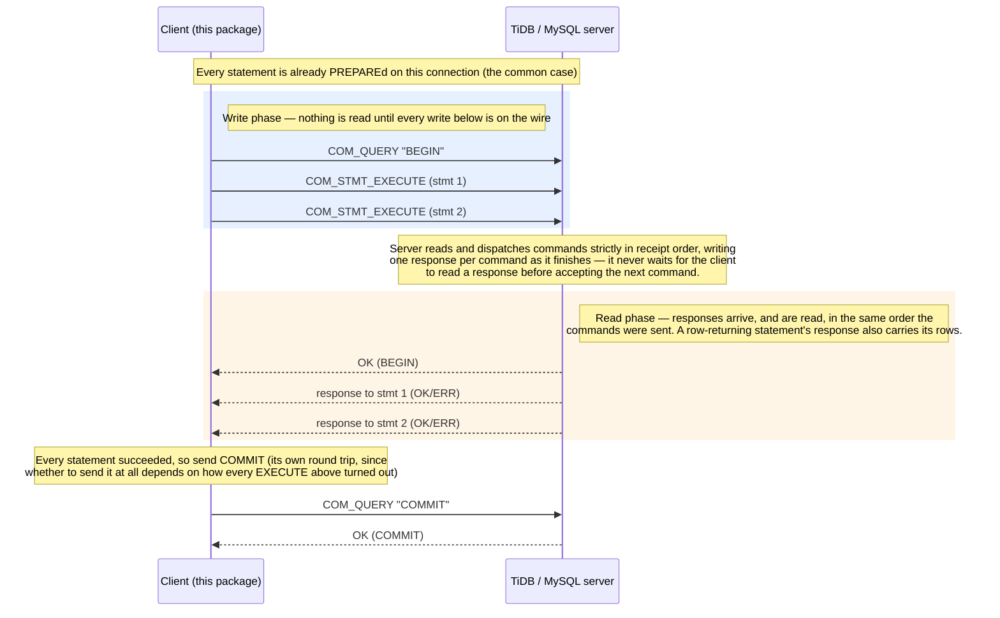

# tidb-binary-multistmt — Specification

## 0. Purpose of this document

This is the specification this package was built from — not a retrofit summary, but the actual requirements, constraints, and hard-won design decisions, reconstructed after the fact from the implementation's own behavior and from the design conversation that produced it. It is published alongside the code so that someone who wants a different implementation (a different language, a different scope, a fork with different tradeoffs) can hand this file to an LLM coding agent and get a working reimplementation without needing to read or port the Go source at all. If this document and the shipped code ever disagree, treat that as a bug in whichever one is wrong — file it.

Read this top to bottom if you're implementing from scratch. Read a specific section if you're changing one behavior and want to know what invariant you might be about to break.

## 1. System requirements — the problem this solves

`database/sql` (and every driver under it, including go-sql-driver/mysql) enforces a strict **write-one-command, synchronously-read-its-response** cycle per `Exec`/`Query` call. For a transaction of N statements, that's N network round trips plus one each for `BEGIN` and `COMMIT`.

MySQL's wire protocol does not require this. Every command packet is self-delimited (a 3-byte length header + 1-byte sequence number + payload), and the server reads one command, dispatches it, writes its response, and loops back to read the next command — it does not care whether the next command's bytes arrived because the client waited for the previous response first, or because the client wrote everything it had queued in one `write()` syscall before reading anything back. A client that writes N commands back-to-back and only then reads N responses, in order, gets a correct result, because TCP delivers bytes in order and the server answers commands in the order it received them.

**Requirement**: given a batch of N SQL statements meant to run as one transaction, execute all N statements (plus `BEGIN` and `COMMIT`) over however few network round trips the wire protocol actually requires — ideally one — while:

- Each statement's individual success/failure and result (if any) must still be attributable to that specific statement, not just "the batch as a whole."
- Row-returning statements' results must be streamable, not force-buffered into memory, so a large result set doesn't blow up memory just because it's inside a pipelined batch.
- The common case (every statement's SQL text already seen on this connection) should cost exactly the number of round trips the wire protocol needs, not more.
- Callers should not have to abandon `go-sql-driver/mysql`'s handshake/auth/TLS-negotiation machinery to get this — only the post-handshake read/write loop needs replacing.

This is a library, not an application: it has no opinion about retry policy, connection string parsing beyond what go-sql-driver/mysql already does, or ORM integration. It solves exactly "pipeline a batch of statements, get back per-statement attributable results," and nothing else.

## 2. Constraints — deliberate, permanent scope boundaries

These aren't bugs to fix later. They follow from the core design (see §3) and are listed here so an implementer doesn't accidentally "fix" one and break something else.

- **Only pessimistic transactions.** A statement failing mid-pipeline does not stop the EXECUTEs already written from running — each is an independent command to the server, which has no idea they're "one batch." Row locks must already be held as each statement executes (not deferred to COMMIT) for "any failure → roll back everything" to stay correct. Optimistic transactions defer conflict detection to COMMIT (prewrite) time: a conflict there fails the whole transaction at once with no way to attribute it back to the one statement that collided, which defeats the entire per-statement-attribution point of this package. This is not planned to change.
- **No TLS.** The connection-hijacking technique (§3.1) captures the raw `net.Conn` *before* go-sql-driver/mysql would wrap it in `tls.Client(...)` during the handshake. Writing this package's own raw bytes onto that captured connection, when the DSN requested TLS, means writing plaintext onto a socket the server now expects to be TLS-encrypted — protocol corruption, not a recoverable error. Only use this package where TLS isn't required (e.g. a private network link) until someone solves capturing the connection *after* TLS is established.
- **No protocol compression** (`compress=true`), for the identical reason as TLS: the dial hook captures the connection before go-sql-driver/mysql would apply compression framing.
- **No `COM_STMT_SEND_LONG_DATA`.** Every parameter value, and every PREPARE/EXECUTE payload, must fit in one MySQL packet (payload length ≤ 2²⁴−1 bytes, see §10.1). This is generous for ordinary column values but a real ceiling for large BLOB/TEXT parameters.
- **Assumes `CLIENT_DEPRECATE_EOF` is never negotiated.** go-sql-driver/mysql doesn't request this capability today (verified by reading its source). If a vendored driver version starts negotiating it, every EOF-packet assumption in this package's wire parsing (§10) needs re-auditing — the failure mode is a silent parse desync, not a loud error.
- **No custom command multiplexing.** This package only ever sends `COM_QUERY` (for `BEGIN`/`COMMIT`/`ROLLBACK`), `COM_STMT_PREPARE`, `COM_STMT_EXECUTE`, and `COM_STMT_CLOSE`. It does not invent a new command code for "batch EXECUTE" — that would break wire compatibility with every tool that isn't this package.
- **Single-writer per `Conn`.** A `Conn` is not safe for concurrent use, mirroring `*sql.Conn`'s own single-writer assumption. Concurrency is achieved by holding multiple `Conn`s (see the connection pool, §4.1), not by sharing one.

## 3. Design & implementation approach

### 3.1 Connection hijacking

Register a custom dial function via go-sql-driver/mysql's own **public** extension point, `mysql.RegisterDialContext`. The hook's `net.Dialer.DialContext` result is captured into a channel (or, for the pooled variant, a per-request channel keyed by a context value — see §4.1) at the moment it's created, while still handing that same `net.Conn` back to the driver so the driver completes its normal handshake/auth (and, when applicable, STARTTLS) over it. Once `sql.Open`+`db.Conn(ctx)` returns, authentication is done; from that point on, this package reads and writes raw bytes on the captured `net.Conn` directly. The `*sql.Conn`/`*sql.DB` pair stays open only to hold whatever pooling slot it represents and must never again be used through the driver API — this package's raw writes permanently desync the driver's internal per-connection packet-sequence-number bookkeeping.

One subtlety: the driver's handshake leaves an **absolute** `SetReadDeadline`/`SetWriteDeadline` on the captured `net.Conn` (derived from the DSN's `readTimeout`/`writeTimeout`). Left in place, it expires on its own schedule regardless of when this package next reads/writes, causing a spurious `i/o timeout` long after the real handshake finished. Clear it (`nc.SetDeadline(time.Time{})`) immediately after capturing the connection, since this package manages its own read/write timing from there on.

### 3.2 The pipelining principle, generalized

Within one `Execute` call: write `BEGIN` (a `COM_QUERY`) and every statement's `COM_STMT_EXECUTE` packet, back-to-back, in one unbroken sequence of writes — **do not** read `BEGIN`'s response before writing the EXECUTEs. Only after every write is issued, start reading: first `BEGIN`'s own OK/ERR, then each EXECUTE's response, strictly in the order the statements were queued. This works because of the same self-delimited-packet property that lets N EXECUTEs pipeline with each other — mixing command types in the pipelined write batch is not a special case, it's the same principle applied one more time. The effect: once every statement in a batch is already PREPAREd on this connection (the common case — see §3.3), `Execute` costs exactly one round trip beyond the batch's own write (a synchronous `COMMIT` on success), instead of the two round trips a naive "write-then-wait for BEGIN" implementation would cost.

The common case, where every statement is already PREPAREd, looks like this on the wire (a client/server swimlane — the `rect` blocks mark the two phases: a burst of writes with nothing read in between, then a burst of reads in the same order the writes went out):



This diagram assumes every statement is already PREPAREd; a statement whose SQL text hasn't been seen on this connection before needs its own synchronous `COM_STMT_PREPARE` round trip *before* the pipelined exchange above (the next EXECUTE needs the statement ID that PREPARE returns). It also shows the success path only — the corollary below covers what happens if `BEGIN`'s own response comes back as an ERR instead of OK.

Corollary that must be handled explicitly, and the one piece of this design that is easy to get wrong by over-generalizing "treat it like a desync" (see §5.6 for how an earlier draft of this spec itself got this wrong): if `BEGIN` itself comes back as an ERR packet (vanishingly rare — in MySQL/TiDB, issuing `BEGIN` while already inside an explicit transaction implicitly commits the prior one and starts a new one; it doesn't error), the EXECUTEs that were already written right behind it have, by now, already reached the server and been processed **outside** the transaction the caller asked for. This is *not* the same thing as a protocol-level desync, and must not be handled the same way: the wire itself is perfectly intact — `BEGIN`'s ERR response was read correctly, and every EXECUTE behind it is still an independent, well-formed, in-order response, exactly as readable as it would be on the success path. The correct handling is to read every one of those N responses for real (reusing the identical response-reading loop the success path uses — an implementation detail worth factoring into its own shared helper precisely so there's only one place this logic can drift from the normal path; see §5.2 and §5.6), invoke every statement's `Callback` exactly once as usual, and surface the whole thing as a distinct, fully-informed error (`BeginFailedError`, §4.5) rather than discarding a connection that is still perfectly usable. The connection must **not** be marked broken by this path — only a genuine read/write error or malformed packet encountered *while* reading those N responses would justify that, exactly as it would on the normal path.

`COMMIT` is **not** pipelined with the EXECUTEs — it can only be decided (send `COMMIT` vs. leave the transaction open) after every EXECUTE's response has been read and it's known whether every statement succeeded. It is its own synchronous write-then-read step, by necessity.

### 3.3 Prepared-statement caching with bounded LRU eviction

A `Conn` sends `COM_STMT_PREPARE` for a given SQL text at most once per connection lifetime; every later use of identical text reuses the cached statement ID (keyed by exact SQL text — see §5.5's bucketing note for why this matters to `ExpandIn`/`ExpandValues` callers). This is what makes §3.2's "one round trip once everything is prepared" case the common case rather than the exception — a long-lived connection reusing a small set of statement shapes PREPAREs each one exactly once.

The cache is a true LRU (not FIFO), bounded by a configurable limit (`SetStmtCacheLimit`; default: see rationale below). A new statement past the limit evicts the least-recently-used entry and sends `COM_STMT_CLOSE` for it — a fire-and-forget write with no server response at all, per the wire protocol's own definition of that command.

**Default limit rationale**: this package hijacks its connection for exclusive use, so the server-side session's own plan cache (in TiDB: `tidb_session_plan_cache_size`, default 100 plans per session) holds nothing but plans for statements this `Conn` itself prepared. The default client-side limit (90) is set just under that server-side default so that this `Conn`'s own LRU is the one deciding evictions, rather than occasionally racing the server's independent eviction decision — if the client thinks a statement is still cached but the server already evicted its plan under memory/count pressure, EXECUTE still works (the server just re-plans it), but silently pays for a plan rebuild this package thought it had avoided. `n <= 0` disables eviction entirely (the client-side map — and correspondingly the server's own prepared-statement table — then grows without bound for the connection's lifetime; only appropriate when the caller knows the set of distinct SQL shapes is small and fixed).

### 3.4 Streaming row decoding, never full-result-set buffering

A row-returning statement's response header (column-count → column-definition packets → EOF) is parsed up front, but rows themselves are read **one packet at a time, on demand**, never collected into a slice by this package. The mechanism: a `Callback` (see §5.2) is invoked exactly once per statement, synchronously, at the point in the read loop where that statement's response becomes available. For a row-returning statement, the callback receives an iterator reading directly off the shared connection's read side; calling `Next()` decodes and returns exactly one row, pulling the next packet off the wire at that moment — not before.

Because the pipelined response stream is one shared sequence (statement 1's rows, then statement 2's response, then statement 3's, ...), a callback that stops consuming rows before reaching the terminating EOF packet would — if nothing compensated — leave the wire mis-aligned for every statement after it. The implementation's own read loop (`drainExecuteResponse`) is responsible for draining the rest of a statement's rows (undecoded, uninspected) after that statement's callback returns, regardless of whether the callback read zero rows, some rows, or all of them. This is what lets a callback safely do "read the first matching row and stop" without corrupting the rest of the batch — a strictly *more* permissive contract than requiring the caller to always read to EOF itself.

A statement queued with no callback at all is unaffected by this: its rows are still drained (silently, undecoded) for the same wire-alignment reason, so "no callback" is equivalent to "I explicitly don't want this statement's rows," not an error condition.

### 3.5 Trust the wire, not the caller, for anything the wire already tells you

Two examples of this principle, both load-bearing — both are a specific field or byte the wire protocol already hands you, zoomed in on below.

- **Whether a statement returns rows** is read directly from `COM_STMT_PREPARE`'s own response — its column-count field is non-zero if and only if the statement returns rows, per the MySQL binary protocol's own definition. The caller never declares this. (An earlier design had the caller pass a `hasResultSet bool` — see §5.1 for why that was removed.)

  ```
  COM_STMT_PREPARE_OK (the first packet of a successful PREPARE response)

   byte:    0        1  2  3  4     5  6         7  8         9  10
           ┌────────┬──────────────┬───────────┬───────────┬────────┐
           │  0x00  │ statement id │  column   │ parameter │ filler │
           │  (OK)  │  (4 bytes)   │   count   │   count   │(2 byte)│
           └────────┴──────────────┴─────┬─────┴───────────┴────────┘
                                          │
                          column_count > 0  →  this statement returns rows
                          column_count == 0 →  this statement does not
  ```

- **Whether a statement-level failure vs. a connection-level failure occurred** is read from the response's first byte: `0xFF` is an ERR packet (the command reached the server and was rejected — the wire round-tripped correctly, keep the connection and keep reading the batch's remaining responses), anything else unexpected (a read error, a malformed packet, an OK/row-header byte that doesn't match what was expected for this statement) is a protocol-level desync (abort the batch immediately, mark the connection unusable). This distinction threads through the whole implementation: it is also why `CommitError` (§5.4) exists as a separate type from a connection-level `error` return.

  ```
   first byte of the response to an EXECUTE (or to BEGIN/COMMIT/ROLLBACK):

     0x00  →  OK packet       no rows; the statement/command succeeded
     0xFF  →  ERR packet      rejected — but the wire itself round-tripped
                               fine; keep reading the rest of the batch
     anything else
           →  the first byte of a length-encoded integer: the result set's
              column count. Only possible for a statement COM_STMT_PREPARE
              already told us HasResultSet=true for. Column-definition
              packets, an EOF, and the rows themselves follow, in that order.
  ```

  This second fact is what makes pipelining *different* command types together safe, not just pipelining N copies of the same one: a reader never needs to be told in advance what kind of response is coming next — it finds out from that response's own first byte, in real time, as it arrives.

### 3.6 Transaction-outcome semantics

- `Execute` sends `COMMIT` if and only if every statement in the batch succeeded. On any statement failure, it does **not** send `ROLLBACK` — the transaction is left open on the connection for the caller to explicitly resolve (inspect further, decide to roll back, etc.).
- If every statement succeeds but the server then rejects `COMMIT` itself (write conflict, a concurrent schema change invalidating the transaction, GC lifetime exceeded, etc.), that is reported as a distinct `*CommitError`, not folded into "a statement failed" or "the connection broke." Verified empirically against a real server (two sessions racing a write conflict under optimistic mode, to reliably trigger a COMMIT-time rejection even though this package itself only ever runs pessimistic transactions): the server has *already* rolled the transaction back server-side by the time the ERR packet for COMMIT comes back — the session behaves exactly as if ROLLBACK had already run. Consequently: the connection must **not** be marked broken (the wire round-tripped correctly — only the application-level outcome was negative), and the caller must **not** send `ROLLBACK` afterward (there's nothing left to roll back; sending it anyway is harmless, since ROLLBACK with no open transaction is defined as a no-op by MySQL/TiDB, but it accomplishes nothing).
- `ExecuteAutoCommit` (the sibling entry point that skips `BEGIN`/`COMMIT` entirely for a batch that doesn't need cross-statement atomicity) has no COMMIT step and therefore cannot produce a `CommitError`; each statement commits on its own as it runs. Calling "rollback" after it is meaningless (nothing is open) but, per the same no-op rule, harmless if called anyway.
- If `BEGIN` itself is rejected (see §3.2's corollary), that is reported as a third distinct outcome, `*BeginFailedError`, carrying every statement's real per-statement outcome (SQL text, args, and error if any) so the caller — or whatever reads this from a log line — has everything needed to decide what to do, without this package guessing on their behalf. Do not claim, in an error message or in documentation, that an all-succeeded `Statements` list is automatically equivalent to having called `ExecuteAutoCommit`: it is the closest thing to a harmless outcome, but each statement ran as its own independent autocommit transaction with its own start timestamp (not one shared snapshot, the way statements inside one `BEGIN...COMMIT` would have), so an application whose batch depended on every statement observing the same consistent view of the data may have gotten a materially different result even though no individual statement failed. This distinction — "report every statement's status and let the caller judge" rather than "compute and assert a verdict for them" — is deliberate: this package has no way to know whether a given application's correctness actually depended on shared-snapshot semantics, so it must not assume the answer is "no."

## 4. Interface design

This section specifies the public API surface. Names are illustrative of intent; an implementation in a different language should preserve the *behavior*, not necessarily the exact identifier spelling.

### 4.1 Connection construction

- `Dial(ctx, dsn) (*Conn, error)` — one dedicated connection per call, via the hijacking technique in §3.1. The caller owns it for its whole lifetime; `Close` tears it down completely (destroys the socket and the backing driver `*sql.DB`/`*sql.Conn` used only to obtain it).
- `DB`, constructed by `Open(dsn, maxConns) (*DB, error)` — a pool of hijacked connections for a long-running process that doesn't want to pay a fresh dial+auth per batch. `AcquireConn(ctx) (*Conn, error)` hands out an idle connection if one exists, otherwise dials fresh if under `maxConns`, otherwise blocks (respecting `ctx`) until one becomes available. This pool is deliberately **not** `database/sql`'s own pool: this package needs to know *which specific physical connection* it's about to speak raw binary protocol on, the instant it's handed out, and `database/sql`'s pool has no API to tell a caller that up front for a connection being reused from its own idle list. The underlying `*sql.DB` inside `DB` is therefore used only as a dial/auth factory (`SetMaxIdleConns(0)`, `SetMaxOpenConns` left unbounded so the pool doesn't itself trigger a background dial on an ambient context — see implementation note below); `AcquireConn`/`Close`/release implement an independent idle-list on top.
  - Implementation note on avoiding a context-correlation bug: when multiple `AcquireConn` calls can be dialing concurrently, the custom dial hook must disambiguate which pending request a freshly dialed `net.Conn` belongs to — e.g. a per-request ID threaded through `context.WithValue` into the dial, with a map from ID to a dedicated capture channel, cleaned up after the dial resolves either way.
- A connection obtained from `Conn` or from `AcquireConn` is used identically afterward — both produce the same `*Conn` type. `(*Conn).Close()`: for a `Dial`-sourced connection, destroys it; for an `AcquireConn`-sourced connection, returns it to the pool's idle list for reuse *unless* it suffered a connection/protocol-level failure (tracked internally as a `broken` flag — see §3.5's second bullet and §4.5), in which case it is destroyed instead, automatically, so a pool never hands out a connection known to be desynced.
- `(*Conn).SetStmtCacheLimit(n int)` — see §3.3. Call before the connection's first `Execute`/`ExecuteAutoCommit`.

### 4.2 Batching

- `Batch`, constructed by `NewBatch()`, built up via `(*Batch).Add(sqlText string, args []any, cb func(*StatementResult)) *Batch` (chainable). `args` binds positionally to `sqlText`'s `?` placeholders, same convention as `database/sql` and sibling text-protocol packages.
- `ExpandIn(sqlText string, args []any) (string, []any, error)` and `ExpandValues(sqlText string, rows [][]any) (string, []any, error)` — pure text/arg rewriting helpers, called *before* `Add`, that don't touch a `Batch` or the server. `ExpandIn` turns a single `?` placeholder whose corresponding arg is a slice/array (anything except `[]byte`, which stays a single opaque value per `database/sql`'s own convention) into a comma-separated run of that many `?`s, flattening the slice into that many separate args — the mechanism behind `WHERE id IN (?)` plus a Go slice becoming `WHERE id IN (?,?,?)` plus N args. `ExpandValues` is the row-multiplying counterpart: it finds the single parenthesized, placeholder-only tuple template in `sqlText` (e.g. the `(?, ?)` in `INSERT ... VALUES (?, ?)`) and repeats it once per row in a `[][]any`, producing `VALUES (?,?),(?,?),...` plus the flattened, row-major arg list. Both refuse to guess when the input is ambiguous (zero or more than one qualifying placeholder group for `ExpandValues`; mismatched row lengths) or empty (an empty slice arg to `ExpandIn` is an error, not silently rendered as `IN (NULL)`, since that would silently change the query's meaning).

### 4.3 Execution

- `(*Conn).Execute(ctx, *Batch) (*ExecuteResult, error)` — the full pipelined-with-explicit-transaction path described in §3.2 and §3.6.
- `(*Conn).ExecuteAutoCommit(ctx, *Batch) (*ExecuteResult, error)` — identical pipelining, no `BEGIN`/`COMMIT` at all; each statement autocommits as it runs. Trades away cross-statement atomicity for two fewer round trips; appropriate for a read-only batch or one where a partial failure genuinely doesn't need undoing.
- `(*Conn).Rollback(ctx) error` — sends `ROLLBACK`. Call after `Execute` returns `(result with AllSucceeded=false, nil error)` — i.e. a statement failed and the transaction is still open. A no-op (not an error) if called after `ExecuteAutoCommit` or after a `*CommitError`, per §3.6.
- `ExecuteResult` carries exactly one field: `AllSucceeded bool`. No per-statement record survives the call — `Callback` (§4.4) is the only way to observe a statement's outcome, on purpose, so there is exactly one place to look and no risk of two sources of truth disagreeing.

### 4.4 Per-statement results

- `StatementResult`, delivered to a `Batch` entry's callback: `Index int` (position in the batch), `SQL string` (the text as queued), `HasResultSet bool` (server-reported, §3.5), `Err error` (nil on success; a `*SQLError` for a server-reported per-statement failure), `Rows *RowIterator` (non-nil only while the callback runs, only for a row-returning, error-free statement — see §3.4 for lifetime rules: do not retain past the callback's own return).
- The callback fires **exactly once** per statement regardless of which of these paths produced its outcome: (a) the streaming path, when the statement returns rows and the response-reading loop reaches the point of invoking the callback with a live iterator; (b) a synthesized call from the outer execution loop, when the statement fails before ever reaching a result-set header (e.g. an ERR packet in place of the expected column-count byte) — this path never enters the streaming branch internally, so the outer loop is responsible for invoking the callback itself, with `Rows == nil` and `Err` set. An implementation must track, per statement, whether the streaming branch actually ran, and only synthesize the fallback call when it didn't — double-invoking (or never invoking) a callback is the single easiest correctness bug to introduce when modifying this logic (see §5.2).
- `RowIterator`: `Columns() []Column` (name/type/unsigned-flag/decimals per column, decoded from the server's own column-definition packets), `Next() []any` (decode-and-return the next row, or `nil` at end-of-result-set — one value per column, `nil` for SQL `NULL`), `Err() error` (distinguishes a clean end-of-result-set from a failure partway through — check this after `Next()` returns `nil` if that distinction matters to the caller).

### 4.5 Errors

- `SQLError` — wraps a server ERR packet's text; distinguishable via `errors.As` from any other error type this package returns. Its presence on a `StatementResult.Err` or as the direct error from `Execute`/`ExecuteAutoCommit` (for a protocol-level failure, note it is *not* a `*SQLError` — see below) carries the meaning "this specific thing was rejected by the server, the connection is fine."
- `CommitError{Err error}` — see §3.6. `Err` is typically (not necessarily — see the "genuine protocol-level failure reading COMMIT's response" case) a `*SQLError`. Implements `Unwrap() error` so `errors.As`/`errors.Is` chain through to the underlying cause.
- `BeginFailedError{Err error, Statements []BeginFailedStatement}` — see §3.2's corollary and §3.6's last bullet. `Err` is BEGIN's own rejection (typically a `*SQLError`); `Statements` is one `BeginFailedStatement{Index int, SQL string, Args []any, Err error}` per batch statement, in order, `Err` nil for a statement that succeeded under autocommit. `Error()` must render every statement's SQL, args, and status into its message — this type exists specifically so the information needed to decide whether/how to repair a partially-applied batch survives into a log line even if the caller never inspects `Statements` programmatically. Implements `Unwrap() error` through to `Err`, same as `CommitError`. The connection is **not** discarded for this case (§3.2).
- A connection-level/protocol-level failure is returned as a plain `error` (not `*SQLError`, not `*CommitError`, not `*BeginFailedError`) from `Execute`/`ExecuteAutoCommit`, and the connection must be discarded (`Close` it; do not reuse). This is the catch-all for "the wire is no longer trustworthy": a read/write syscall error, a malformed packet, an unexpected byte where a specific one was expected.

### 4.6 Row value type mapping

Binary-protocol row decoding produces, per column, one of: `int64`/`uint64` (signed/unsigned integer families, selected by the column's own unsigned flag), `float64` (FLOAT/DOUBLE), `time.Time` (DATE/DATETIME/TIMESTAMP, decoded from the packed binary date/time format — length byte then that many fields, zero-length meaning the zero value), `time.Duration` (TIME — can be negative; MySQL's TIME type is not bounded to 24 hours, so this must decode a sign bit plus a day count, not just hours/minutes/seconds), or `[]byte` for every string/blob/decimal/JSON/ENUM/SET/BIT/GEOMETRY-family type (this package does not know a column's character set well enough to safely decide when converting to `string` is correct, so it leaves that decision, and its cost, to the caller — this is a deliberate scope boundary, not an oversight).

For the write side (binding `?` parameters in `COM_STMT_EXECUTE`), accept at minimum: `nil`, `bool`, every sized signed/unsigned integer type, `float32`/`float64`, `string`, `[]byte` (both length-prefixed as a binary-protocol string value), `time.Time` (sent as a formatted string value rather than the packed binary struct — simpler to implement, costs nothing in practice since the server accepts a string literal in a date/time parameter position the same way it would in text-protocol SQL), and anything implementing `driver.Valuer` (resolved to its underlying value first, matching `database/sql`'s own convention).

## 5. Design & implementation challenges — things that took more than one attempt

This section exists because several of these are easy to get wrong in a way that compiles, passes a shallow smoke test, and still produces incorrect behavior under a slightly different code path. Treat each as a required test case, not just a design note.

### 5.1 Don't trust a caller-supplied flag for something the wire already states authoritatively

An earlier design had `Batch.Add` take a caller-supplied `hasResultSet bool`. Getting it backward for one call produced a confusing failure mode: the response-reading code, told "no result set" for a statement that actually returned one, would see the result set's column-count byte where it expected an OK packet's `0x00`, and surface a generic protocol error — correctly flagging that *something* was wrong, but for a reason the caller would have to go debug rather than something preventable by construction. Fix: derive `HasResultSet` entirely from `COM_STMT_PREPARE`'s own response (§3.5) and remove the parameter. **Lesson**: whenever a value the wire protocol already encodes is also something the public API is tempted to ask the caller to declare, prefer deriving it — a declared-and-possibly-wrong value is strictly worse than no value at all.

### 5.2 Exactly-once callback invocation across two different code paths

See §4.4's "streaming path vs. synthesized fallback" split. The failure mode when this is implemented carelessly is either a callback silently never firing (if a statement fails via the non-streaming path and nothing calls it) or firing twice (if the streaming branch's own internal invocation isn't tracked and the outer loop calls it again "just in case"). The implementation detail that makes this tractable: a boolean flag, scoped per statement, set by the streaming-path closure the instant it actually runs, checked by the outer loop immediately afterward. Test this with a single batch containing all three shapes in one call — a statement that streams rows and only partially consumes them, a statement with no result set that succeeds normally, and a statement that fails outright before any result-set header — and assert every callback fired exactly once.

### 5.3 Testing pipelined writes requires a test double that itself buffers

`net.Pipe()` (Go's standard in-memory, synchronous, **unbuffered** full-duplex connection) is the natural choice for unit-testing this package's wire logic without a real server. It breaks, in a specific and non-obvious way, the moment a test tries to exercise §3.2's "write BEGIN and N EXECUTEs before reading anything" behavior with a naive fake server that reads-then-immediately-writes-a-response per command (the way one might naturally write a fake server for the *old*, non-pipelined BEGIN behavior): the fake server's response `Write` call blocks until the test's client code reads it, but the client (correctly implementing the real pipelining behavior) hasn't gotten to reading yet — it's still issuing more writes. Meanwhile the fake server's single goroutine, now blocked inside its own `Write` call, can never get back around to `Read`ing the client's next queued write either. Deadlock — not a flaky test, a deterministic one, because `net.Pipe` provides zero buffering (unlike a real TCP socket, which has kernel send/receive buffers that let a real server **read several requests ahead** of the client finishing its writes, which is exactly the real-world behavior this package relies on to begin with).

**Fix, and the general pattern for any fake server exercising this package's pipelined behavior**: structure the fake server to read every command it expects to receive in this exchange *before* writing any of the responses back — i.e., mirror the real behavior being tested (reads run ahead of writes) rather than the naive request-response alternation a non-pipelined protocol would suggest. This is not a workaround for a test-only problem; it is the test correctly modeling what a real buffered TCP connection already does for free, and what a from-scratch reimplementation's own test suite will need to do as well for every scenario that exercises more than one write before a read.

### 5.4 Distinguishing "statement failed" from "COMMIT itself failed" from "connection broke" requires three outcomes, not two

A natural first implementation collapses "the operation failed" into a single `error` return and lets the caller sort it out from the message text. This breaks the one thing callers actually need: knowing whether the connection is still usable, and whether anything already landed. The fix (§3.6, §4.5) is three genuinely distinct outcomes that must be told apart at the point they're detected, not inferred afterward from string matching: a per-statement `*SQLError` (connection fine, that one statement didn't happen, batch may continue), a `*CommitError` (connection fine, every statement individually succeeded, but nothing committed — server already rolled back), and a bare protocol-level `error` (connection must be discarded). Verifying the second case specifically required empirical reproduction against a real server (racing two sessions into a genuine write conflict) rather than reasoning from documentation alone, because the exact post-rejection session state ("is it as if ROLLBACK already ran, or is it in some other limbo state requiring an explicit ROLLBACK, or is ROLLBACK actually forbidden/erroring in this state") is exactly the kind of implementation-defined server behavior that's risky to assume.

### 5.5 Eviction must be observable and bounded for a long-lived connection to stay well-behaved

An unbounded prepared-statement cache (§3.3) is the simpler implementation and works fine for short-lived connections or a small, fixed set of statement shapes. It becomes a real problem for a long-lived, pooled connection fed a large or slowly-growing set of distinct SQL texts (notably: `ExpandIn`/`ExpandValues` callers whose slice/row-count varies — each distinct length is cache key, so an uncapped cache plus varying-length input is unbounded growth in slow motion). The fix is LRU eviction with a real "least-recently-used," not FIFO (touching an already-cached entry must move it to the front, not just insertions) — otherwise a hot statement that happens to have been prepared early can get evicted ahead of a cold one that was merely prepared more recently. `COM_STMT_CLOSE` must be sent for whatever's evicted (it has no response — fire-and-forget, do not attempt to read anything back for it) so the server-side prepared-statement table doesn't grow in lockstep with an otherwise-bounded client-side cache.

### 5.6 "Treat it like a desync" is the wrong default for a semantic-only failure, and "all succeeded" is not automatically "safe"

The first design for §3.2's BEGIN-rejection corollary got this wrong in two compounding ways, both worth stating explicitly because the same shape of mistake generalizes beyond this one scenario:

First, it classified "BEGIN was rejected, but the EXECUTEs behind it are still readable" as if it were the same category of problem as a genuine protocol-level desync (a read error, a malformed packet) — and prescribed the same remedy, discarding the connection, even though the wire had not actually desynced at all. The tell that should have caught this earlier: a protocol-level desync is defined by *not knowing* how to interpret subsequent bytes; this case has no such ambiguity — every EXECUTE's response is exactly as well-formed and exactly as readable, in order, as it would be on the success path. Conflating "the caller's semantic expectation (a transaction) wasn't met" with "the connection can no longer be trusted" throws away real, readable information (every statement's actual outcome) and forces a reconnect that isn't actually necessary. **Lesson**: before reaching for "discard and reconnect" as the response to an unexpected server reply, check specifically whether the wire's framing/ordering guarantee was actually violated — if every subsequent packet is still exactly where it's expected to be, it almost always is not a desync, just an outcome the happy path didn't plan for.

Second, even after fixing the above to report every statement's real outcome, the first version of that report characterized an all-succeeded `Statements` list as equivalent to having called `ExecuteAutoCommit` — i.e., implicitly asserting "nothing needs repairing." This is still an overclaim: each statement, having run under autocommit instead of inside the intended transaction, got its own independent start timestamp rather than sharing one transaction's consistent snapshot. A batch whose correctness depended on every statement seeing the same point-in-time view of the data (two `SELECT`s expected to agree with each other, a later write implicitly relying on an earlier read not having changed underneath it) can have silently produced a different, wrong result — with every individual statement nonetheless reporting success. **Lesson**: when a package cannot know whether a specific correctness property (here, cross-statement snapshot consistency) mattered to the caller's actual use case, it must not compute and assert a verdict ("this is fine") on the caller's behalf — report the facts (every statement's outcome) and the one subtlety that can't be seen from the facts alone (the shared-snapshot guarantee was lost), and let the caller, who has the context this package doesn't, make the call.

## 6. Usage

```go
conn, err := binarymultistmt.Dial(ctx, "user:pass@tcp(host:4000)/db")
if err != nil { /* handle */ }
defer conn.Close()

var failed []string
b := binarymultistmt.NewBatch()
b.Add("INSERT INTO accounts (id, balance) VALUES (?, ?)", []any{1, 100}, func(sr *binarymultistmt.StatementResult) {
    if sr.Err != nil {
        failed = append(failed, fmt.Sprintf("#%d (%s): %v", sr.Index, sr.SQL, sr.Err))
    }
})
b.Add("SELECT balance FROM accounts WHERE id = ?", []any{1}, func(sr *binarymultistmt.StatementResult) {
    if sr.Err != nil {
        failed = append(failed, fmt.Sprintf("#%d (%s): %v", sr.Index, sr.SQL, sr.Err))
        return
    }
    for row := sr.Rows.Next(); row != nil; row = sr.Rows.Next() {
        fmt.Println("balance:", row[0])
    }
})

res, err := conn.Execute(ctx, b)
var commitErr *binarymultistmt.CommitError
var beginErr *binarymultistmt.BeginFailedError
switch {
case errors.As(err, &commitErr):
    // every statement succeeded; COMMIT itself was rejected (e.g. a write
    // conflict). The server already rolled back — conn is still healthy,
    // nothing to roll back. Decide whether to retry the whole batch.
case errors.As(err, &beginErr):
    // BEGIN itself was rejected (vanishingly rare) — every statement
    // already ran under autocommit instead of inside a transaction. conn
    // is still healthy; beginErr.Error() already renders every
    // statement's SQL, args, and outcome. Even an all-succeeded
    // beginErr.Statements is not automatically "nothing to repair" — see
    // §3.6 and §5.6 for why cross-statement snapshot consistency was lost
    // regardless of each statement's individual outcome.
    log.Println(beginErr)
case err != nil:
    // connection/protocol-level failure — conn is no longer usable
    conn.Close()
    return err
case !res.AllSucceeded:
    // one or more statements failed (see `failed`, populated by callbacks
    // above); Execute did NOT send ROLLBACK — decide what to do, then act:
    if err := conn.Rollback(ctx); err != nil { /* handle */ }
default:
    // every statement succeeded — Execute already sent COMMIT.
}
```

For a long-running process reusing connections across many batches, use the pool instead of `Dial`:

```go
db, err := binarymultistmt.Open("user:pass@tcp(host:4000)/db", 40) // maxConns
conn, err := db.AcquireConn(ctx)
defer conn.Close() // returns conn to db's idle pool, unless it was marked broken
```

A read-only or best-effort batch that doesn't need cross-statement atomicity should use `ExecuteAutoCommit` instead of `Execute` to save the `BEGIN`/`COMMIT` round trips.

## 7. Code style and quality requirements

- **Comments explain *why*, never *what*.** A well-named identifier already says what the code does; a comment repeating that is noise. Write a comment only when there's a non-obvious invariant, a workaround for specific server/driver behavior, a reason a simpler-looking alternative doesn't work, or context a future reader would otherwise have to rediscover by git-blaming and re-deriving (e.g. §5's entries — every one of those became a comment at the exact place its lesson applies, not a separate design-notes file disconnected from the code).
- **No speculative abstraction.** Don't add a parameter, an interface, or a configuration knob for a use case that doesn't exist yet. `SetStmtCacheLimit` exists because the default needs to be overridable against a cluster with a non-default server-side setting — a concrete, named need, not "someone might want to configure this someday."
- **Minimal, single-path public API.** When a design decision removes a redundant way to get the same information (e.g. removing `ExecuteResult.Results`/`StatementResult.Result` once `Callback` could deliver everything), delete it outright rather than keeping both paths "for compatibility" or marking one deprecated. Two ways to read the same result invite them to disagree, or invite a caller to read the wrong one and miss data the other path had.
- **No defensive code for scenarios the protocol/environment guarantees can't happen.** Validate at the actual boundary (parsing untrusted bytes off the wire, §8) — don't add nil checks or range checks for values this package itself just constructed and controls.
- **Every exported identifier has a godoc comment that is the canonical documentation**, not an afterthought relative to the README. The generated API reference (§9) is produced directly from these comments — a behavior change that isn't reflected in the relevant godoc comment is treated as an incomplete change, not a documentation gap to backfill later.
- **Go-standard tooling as the baseline gate for every change**: `go build ./...`, `go vet ./...` (including `-tags integration`, so the integration-test-only files are vetted too), `go test -race ./...`. A change isn't done until all three are clean.

## 8. Testing requirements

Three layers, each covering a different class of correctness:

1. **Unit tests against a fake server**, driven over `net.Pipe` (hand-crafted raw packet bytes, no real database needed). This layer covers wire-protocol-level logic in isolation: packet encoding/decoding, the exactly-once-callback contract (§5.2), eviction triggering `COM_STMT_CLOSE` with the right statement ID, `CommitError` classification. Every such test must account for §5.3's buffering pitfall when it exercises more than one write before a read.
2. **Integration tests against a real server** (gated behind a build tag, e.g. `integration`, and an environment variable carrying the test DSN, so they're opt-in and don't require infrastructure for a normal `go test`). This layer covers end-to-end correctness that a fake server can't convincingly fake: real transaction semantics (a duplicate-key failure mid-batch is attributed to the right statement and leaves the transaction open), real `*CommitError` reproduction (two connections racing a genuine write conflict — not a scripted ERR packet), real LRU eviction (set a small limit, force an eviction, confirm the evicted statement's SQL text still works correctly when reused — i.e. that eviction doesn't leave either side's bookkeeping in a state that breaks a later re-PREPARE), and the pipelined-`BEGIN` behavior (§3.2) producing a correctly committed transaction, not just a correctly-shaped wire exchange.
3. **Fuzz testing** on every entry point that parses bytes arriving off the wire (as opposed to bytes this package generated itself) — packet-length parsing, column-definition decoding, binary-row decoding, the full OK/ERR/column-defs/EOF/rows response-reading loop. The property under test is simply "never panic" on adversarial or truncated input; a returned error is the correct outcome for garbage input, a panic is not. Seed the corpus with at least one well-formed example and at least one pathological one (empty input, truncated mid-field) per target. This is not optional hardening — an earlier version of this package had exactly one real bug caught this way: an untrusted column-count value used directly as a slice-capacity argument, panicking on a maliciously or accidentally huge value.

## 9. Documentation site requirements

- **README** covering, at minimum: a one-paragraph "at a glance" summary (what/benefit/tradeoff) before anything else, a measured performance comparison against the naive one-round-trip-per-statement baseline, usage examples matching §6 exactly (code blocks here and in any generated API reference must be byte-identical, not just similar), the full list of constraints from §2 under a clearly labeled "known limitations" heading, and a "status" section listing what's been empirically verified against a real server (not just unit-tested) and how.
- **Multi-language README parity, if multiple languages are offered**: translate prose; keep every code block's actual code (not its comments) byte-for-byte identical across languages — verify this mechanically (strip comments, diff) rather than by eye, since a translator naturally wants to "helpfully" adjust example code and that's exactly what must not happen.
- **Generated API reference from godoc comments** (not hand-written and separately maintained) — regenerate it as part of any change that touches an exported identifier's documentation, so the generated reference and the source comments can never drift apart. If the reference is published somewhere with its own presentation layer (e.g. a static site), verify the generated output actually renders usably (readable code-block width, working internal anchor links — note that heading-to-anchor slug generation can have surprising whitespace-collapsing rules around punctuation; verify an anchor's real generated ID against the actual rendering rather than computing it by hand) rather than assuming the generator's default output is presentation-ready.
- **Every documented numeric claim (round-trip counts, latency figures, CPU percentages) must cite how it was measured** (a real cluster vs. a loopback microbenchmark vs. a theoretical count) — these numbers mean different things and get confused if presented without that context, especially since loopback benchmarks systematically understate the benefit of round-trip reduction (near-zero RTT hides exactly the saving this package exists to capture).

## 10. Appendix — wire-level reference for a from-scratch reimplementation

This is the minimum protocol knowledge needed to reimplement §3 without access to a MySQL/TiDB protocol reference document. (It is not a substitute for one if something here is ambiguous — cross-check against the official MySQL client/server protocol documentation for anything not covered.)

### 10.1 Packet framing

Every command and response is one or more packets: a 4-byte header (3-byte little-endian payload length + 1-byte sequence number) followed by that many payload bytes. Every new command this package issues uses sequence number `0` (this package never continues a single logical command across more than one packet — see the `COM_STMT_SEND_LONG_DATA` exclusion in §2 — so it never needs to increment the sequence number within one command). Maximum payload length a single packet's 3-byte length field can express is 2²⁴−1 bytes; this package does not implement splitting a larger payload across multiple packets.

### 10.2 Relevant command bytes

- `COM_QUERY = 0x03` — text-protocol query; used only for `BEGIN`/`COMMIT`/`ROLLBACK` in this package.
- `COM_STMT_PREPARE = 0x16` — payload is the command byte followed by the raw SQL text (with `?` placeholders).
- `COM_STMT_EXECUTE = 0x17` — see §10.4 for payload layout.
- `COM_STMT_CLOSE = 0x19` — payload is the command byte followed by the 4-byte little-endian statement ID. No response packet of any kind follows this command.

### 10.3 `COM_STMT_PREPARE` response

First packet: `0x00` status byte, 4-byte little-endian statement ID, 2-byte little-endian column count, 2-byte little-endian parameter count, then (per the protocol) 2 filler/warning bytes not needed by this package. If parameter count > 0: that many parameter-definition packets, then one EOF packet. If column count > 0: that many column-definition packets (§10.5 format), then one EOF packet. The column count from this response is the authoritative source for whether the statement returns rows (§3.5) — do not discard it after using it only to count packets to skip.

### 10.4 `COM_STMT_EXECUTE` payload

Command byte, 4-byte little-endian statement ID, 1-byte flags (`0x00` = `CURSOR_TYPE_NO_CURSOR`, the only mode this package needs), 4-byte little-endian iteration count (always `1`). If the statement has parameters: a null-bitmap (`(num_params + 7) / 8` bytes, bit set means that parameter is NULL), a 1-byte "new params bound" flag (`0x01`, meaning type information follows), then for each non-NULL parameter in order: a 2-byte type/unsigned-flag pair, followed later (after all type pairs) by that parameter's encoded value — integers and floats as fixed-width little-endian, strings/bytes as a length-encoded integer followed by that many raw bytes, temporal values as a length-encoded string (this package sends `time.Time` as a formatted string value rather than implementing the packed binary temporal encoding — see §4.6).

### 10.5 Column-definition packet (`Protocol::ColumnDefinition41`)

Four length-encoded strings (catalog, schema, table, original-table — unused by this package, must still be consumed to advance the cursor correctly), length-encoded column name, length-encoded original column name, a length-encoded integer giving the length of the fixed-size field block that follows (must be ≥ 10), then that many bytes laid out as: 2-byte charset, 4-byte column length, 1-byte column type, 2-byte flags (bit `0x0020` is the unsigned flag), 1-byte decimals, then 2 filler bytes not needed by this package.

### 10.6 Binary row packet

A leading `0x00` header byte, then a null-bitmap of `(num_columns + 7 + 2) / 8` bytes — note the `+2`, a fixed 2-bit offset before the first column's bit that the plain `COM_STMT_EXECUTE` null-bitmap (§10.4) does not have; this is a different, row-specific bitmap layout, not the same bitmap reused. For each non-NULL column, in order, decode per its column type (§10.7).

### 10.7 Column type decoding (binary protocol row values)

- `TINY` (1 byte), `SHORT`/`YEAR` (2 bytes LE), `LONG`/`INT24` (4 bytes LE), `LONGLONG` (8 bytes LE): fixed-width little-endian integer, signed or unsigned per the column's own unsigned flag (§10.5).
- `FLOAT` (4 bytes LE, IEEE-754 single precision), `DOUBLE` (8 bytes LE, IEEE-754 double precision).
- `DATE`/`DATETIME`/`TIMESTAMP`: 1-byte length (`0`, `4`, `7`, or `11`), then that many bytes: 2-byte year, 1-byte month, 1-byte day, and if length ≥ 7: 1-byte hour/minute/second each, and if length ≥ 11: 4-byte microseconds. Length `0` means the zero value.
- `TIME`: 1-byte length (`0`, `8`, or `12`), then: 1-byte is-negative flag, 4-byte LE day count, 1-byte hour/minute/second each, and if length ≥ 12: 4-byte microseconds. Note this type is **not** bounded to 24 hours (the day count can be nonzero) and can be negative — decode into a type that preserves both, not a naive wall-clock time-of-day.
- Everything else this package handles (`DECIMAL`/`NEWDECIMAL`, `VARCHAR`/`VAR_STRING`/`STRING`, `*BLOB`, `JSON`, `ENUM`, `SET`, `BIT`, `GEOMETRY`): a length-encoded integer followed by that many raw bytes, returned as an opaque byte slice (§4.6 explains why this package never attempts a string conversion itself).
- `NULL` type code: should not actually appear here (NULL columns are signaled by the row's null-bitmap, §10.6, and never reach per-value decoding) — treat encountering it as returning a nil value rather than an error, as a defensive fallback, but it indicates the null-bitmap path wasn't taken as expected if it happens.

### 10.8 Length-encoded integers (used throughout: column counts, string lengths, etc.)

First byte `< 0xfb`: that byte is the value. `0xfc`: next 2 bytes, little-endian, is the value. `0xfd`: next 3 bytes, little-endian, is the value. `0xfe`: next 8 bytes, little-endian, is the value. (`0xfb` itself is reserved as a NULL marker in a different encoding context — length-encoded strings — and should not be produced by this package's own integer encoder; when decoding, treat it as invalid in a context where a plain length-encoded integer, not a possibly-NULL length-encoded string, is expected.)
